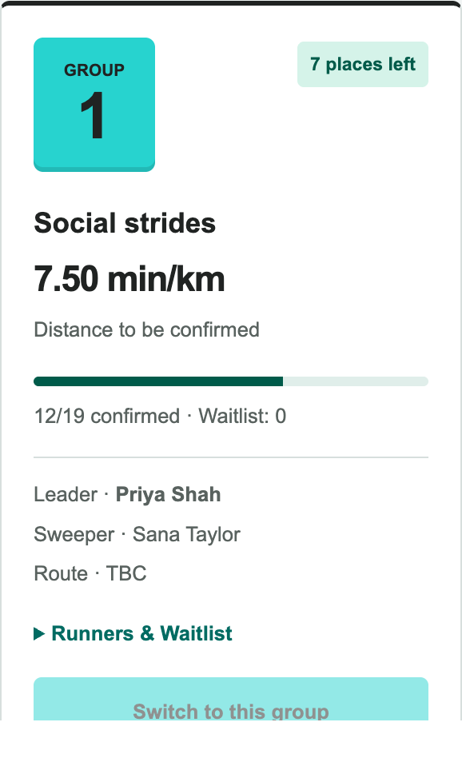
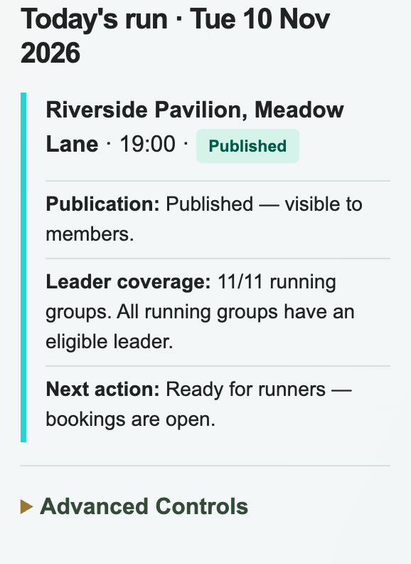

# Tuesday Club Runs

A web app for organising a running club's weekly Tuesday runs. Members can see
upcoming runs, book a place or join a waitlist, and check their running history.
Club leaders manage their groups, while organisers manage members, schedules,
venues and weekly run setup.

[Open the live demo](https://running-club-organiser-xi.vercel.app)

## Features

- Public run information and member-only bookings, rosters and personal history
- Capacity-aware bookings, waitlists and attendance tracking
- Leader tools for group routes, volunteers and attendance
- Admin tools for members, groups, venues, schedules and weekly leader assignments
- Optional weekly run preparation, publication and archiving
- Booking-demand and group-popularity analytics

## Demo screenshots

These screenshots use synthetic demo data. Names, venue and schedule are
examples only.

**Runner view — group pace, capacity, leader and booking status**



**Admin view — publication status and leader coverage**



## Stack

- Next.js App Router, React and TypeScript
- Clerk for invitation-only sign-in
- Google Sheets for club data, accessed through a server-side Apps Script gateway
- Zod for data validation; Vitest and ESLint for tests and linting

## Run locally

```sh
npm ci
cp .env.example .env.local
npm run dev
```

Set `CLUB_DEMO_MODE=true` in `.env.local` to try the app with synthetic data.
Demo data is temporary and isolated from the club workbook; never enable demo
mode on the live member app.

```sh
npm test
npm run lint
npm run build
```

## Documentation

- [Setup and deployment](docs/setup-and-deployment.md): environment, Clerk,
  Google Sheets and Apps Script configuration
- [Weekly operations](docs/weekly-operations.md): automation, leader imports
  and workbook procedures
- [Bookings, roles and data](docs/bookings-and-data.md): booking rules,
  permissions, privacy and analytics
- [Admin workflow integration](docs/admin-workflows.md): implementation
  details for admin workflows and their APIs

The demo venue, schedule, timezone and group definitions are examples. Confirm
the club's real settings and test against a staging workbook before production.
Automated tests use mocked external services and do not verify live deployments,
email delivery or workbook permissions.
